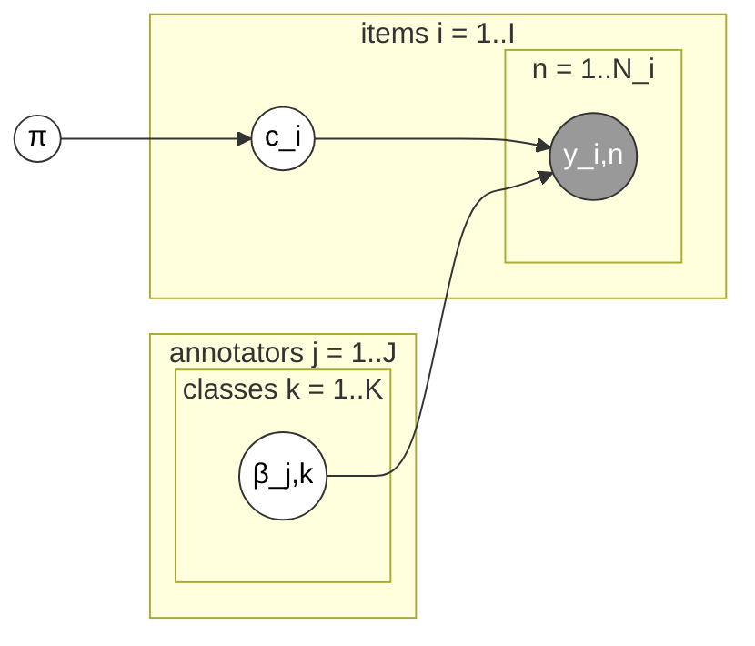

# Dawid & Skene (`d&s`)

The classic model (Dawid & Skene, 1979). Every annotator `j` has their own
`K x K` confusion matrix: if the true class is `h`, some fixed probability
governs which class `j` reports. Some annotators are close to the identity
matrix (accurate); some are noisy; some systematically confuse two specific
classes.

Stan file: `DS.stan` — implementation from Paun et al. (2018)'s
supplementary material (CC-BY 4.0), not original to this library; see
[Contributing](../contributing.md). Generative story:

```stan
parameters {
  simplex[K] pi;
  array[J,K] simplex[K] beta;  // beta[j, true_class] is annotator j's confusion row
}
```

Plate diagram (redrawn from Paun et al. 2018, Figure 2):



**Good for:** the default choice, once you have a reasonable number of
annotations per annotator (a handful of dozens, not two or three) to
actually estimate a personal confusion matrix.

**`difficulty`:** the generic entropy fallback (no native difficulty
parameter). **`credibilities`:** the uniform post-inference formula. D&S's
own fitted confusion matrix (`beta`) is richer and remains available via
`model.idata` for anyone who wants the full per-class error breakdown.
