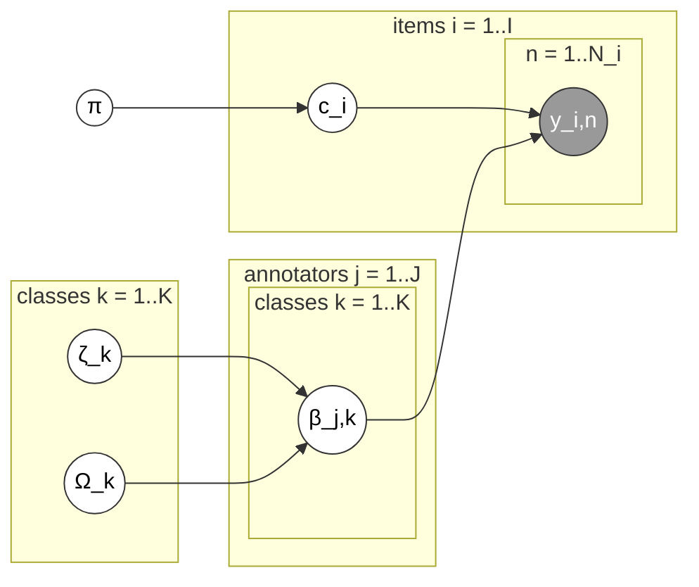

# Hierarchical Dawid & Skene (`hier_d&s`)

Same generative story as D&S, but each annotator's confusion matrix is now
drawn from a shared population distribution instead of estimated fully
independently — an annotator who's only labeled 3 items still gets a
sensible, regularized estimate (shrunk toward the population mean) instead
of a wild, overfit one.

Stan file: `HDS-NC.stan` (non-centered parameterization, for sampling
efficiency — see [Diagnostics](../user_guide/diagnostics.md)) —
implementation from Paun et al. (2018)'s supplementary material (CC-BY
4.0), not original to this library; see [Contributing](../contributing.md).

Plate diagram (redrawn from Paun et al. 2018, Figure 4) — same as D&S,
except each annotator's confusion row `β_j,k` is now itself drawn from a
shared, class-level population mean `ζ_k` and scale `Ω_k`:

**Good for:** datasets with a long tail of annotators contributing very few
labels each — exactly the shape open crowdsourcing produces, and exactly
the case where plain D&S's per-annotator estimates get noisy.

**`difficulty`:** the generic entropy fallback. **`credibilities`:** the
uniform post-inference formula.
