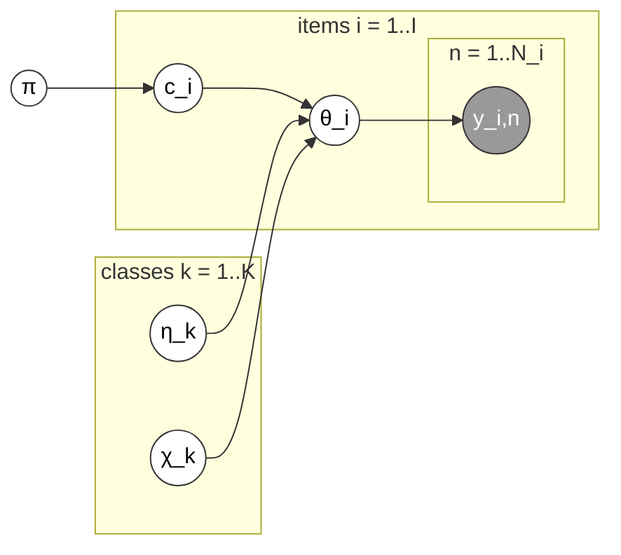

# Item Difficulty (`item_difficulty`)

Flips the emphasis of D&S: instead of modeling *who's* annotating, it
models *what's being annotated*. Every item has its own latent per-class
confusion profile, drawn from a class-level hierarchical prior, with no
annotator structure at all.

Stan file: `ID-NC.stan` — implementation from Paun et al. (2018)'s
supplementary material (CC-BY 4.0), not original to this library; see
[Contributing](../contributing.md).

Plate diagram (redrawn from Paun et al. 2018, Figure 5) — no annotator
plate; instead every item gets its own difficulty profile `θ_i`, drawn from
class-level hierarchical means `η_k` and scales `χ_k`:

**Good for:** when Q2 (item difficulty) is the primary interest — dataset
curation, error analysis, finding genuinely ambiguous items rather than
just badly-labeled ones.

**`difficulty`:** model-native, not the generic entropy fallback — derived
from the item's own fitted per-class confusion structure
(`theta_norm[I, K, K]`): `1 - sum_h pi[h] * exp(theta_norm[i, h, h])`, the
item's expected "own-class" inaccuracy. **`credibilities`:** still works
via the uniform post-inference formula, even though this Stan file has no
annotator dimension at all.
