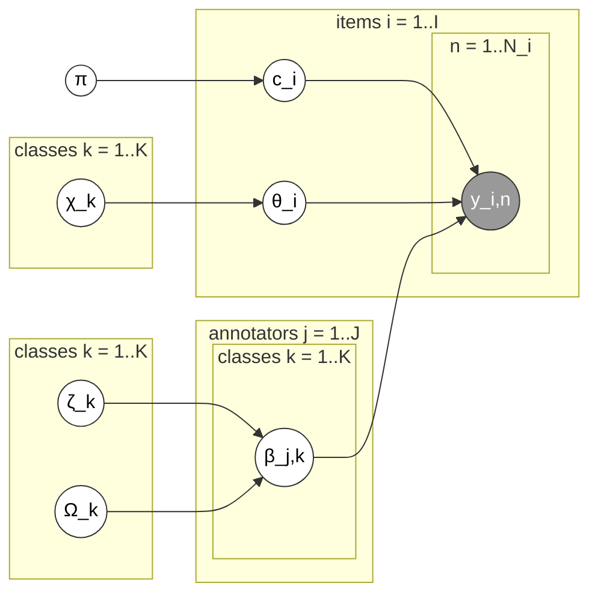

# Logistic Random Effects (`lre`)

The "give me everything" model (Carpenter, 2008). Combines Hierarchical
D&S's annotator-ability structure and Item Difficulty's per-item difficulty
structure into one IRT-style model: the probability of a correct annotation
is a function of annotator ability minus item difficulty — the same
intuition as item-response theory in psychometrics/education testing.

Stan file: `LRE-NC.stan` — implementation from Paun et al. (2018)'s
supplementary material (CC-BY 4.0), not original to this library; see
[Contributing](../contributing.md).

Plate diagram (redrawn from Paun et al. 2018, Figure 6) — combines
Hierarchical D&S's annotator-ability plates (`β_j,k`, drawn from `ζ_k`/`Ω_k`)
with Item Difficulty's per-item plate (`θ_i`, drawn from `χ_k`); both feed
into `y_i,n`:

!!! note "One deliberate addition to this file"
    The bundled `LRE-NC.stan` adds a small, purely-additive `generated
    quantities` block (`beta_norm`, `theta_norm`) that the paper's original
    supplementary material doesn't have — `HDS-NC.stan` and `ID-NC.stan`
    already compute their analogous normalized quantities, but LRE-NC only
    had them as local variables inside its `model` block. The addition
    doesn't touch `parameters`/`model`, so posterior samples are
    bit-for-bit unaffected; it only exposes quantities PyRater needs to
    compute native difficulty without reimplementing Stan's own softmax
    transform in Python. See the comment at the top of the bundled file.

**Good for:** when you need all three answers (labels, difficulty,
credibilities) well-estimated from the same fit, and have enough data — this
is the model with the most parameters, so it wants the most data to be
well-identified.

**`difficulty`:** model-native, the same formula as `item_difficulty`.
**`credibilities`:** the uniform post-inference formula; a model-native
annotator-ability parameter (`beta_norm`) is also available via
`model.idata`.
