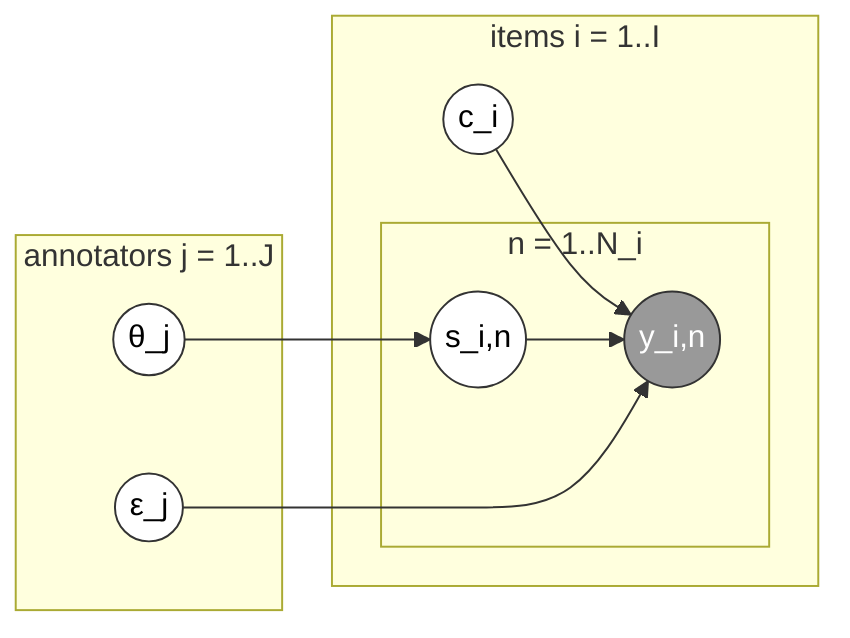

# MACE (`mace`)

Multi-Annotator Competence Estimation (Hovy et al., 2013). Simpler than
D&S: every annotation is either "trustworthy" (reports the true label) or
"spamming" (reports something drawn from the annotator's own noise
distribution), governed by a per-annotator competence scalar `theta[j]`.

Stan file: `MACE.stan` — implementation from Paun et al. (2018)'s
supplementary material (CC-BY 4.0), not original to this library; see
[Contributing](../contributing.md).

Plate diagram (redrawn from Paun et al. 2018, Figure 3) — a per-annotation
spamming indicator `s_i,n` (governed by annotator competence `θ_j`) selects
whether `y_i,n` copies the true class `c_i` or is drawn from the
annotator's own noise distribution `ε_j`:

**Good for:** noisy crowdsourcing pools with a mix of genuine and
careless/adversarial annotators, especially with a largish `K` (MACE's
scalar competence is cheaper to estimate reliably than D&S's full `K x K`
matrix when data per annotator is limited).

**A quirk worth knowing:** MACE is the only one of the six models immune to
the label-switching problem — its likelihood anchors the latent class axis
directly to the observed label codes (`y[n] == h`), so `class_indexed_params
= {}` and chain alignment is a deliberate no-op.

**`difficulty`:** the generic entropy fallback. **`credibilities`:** the
uniform post-inference formula; MACE's own native `theta[j]` ("probability
this annotator is trustworthy") is available via `model.idata` alongside it.
