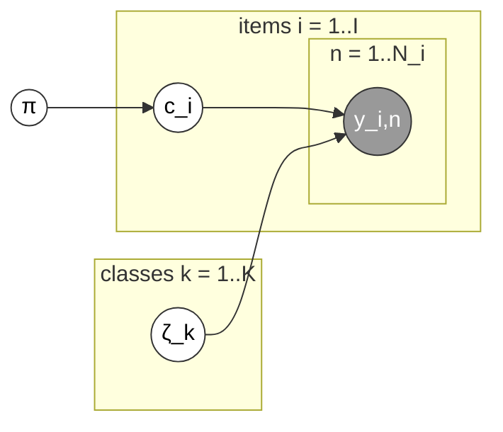

# Multinomial (`multinomial`)

The simplest pooled model: a single, shared confusion matrix for the whole
crowd (Albert & Dodd, 2004; Carpenter, 2008). No per-annotator structure at
all — the Stan file has no `J`/`jj` in its `data` block.

Stan file: `Multinomial.stan` — implementation from Paun et al. (2018)'s
supplementary material (CC-BY 4.0), not original to this library; see
[Contributing](../contributing.md).

Plate diagram (redrawn from Paun et al. 2018, Figure 1) — the simplest of
the six: no per-annotator plate at all, just one shared confusion matrix
`ζ_k` for the whole crowd:

**Good for:** a fast baseline, or datasets where the *model itself* doesn't
need to reason about who annotated what.

**`difficulty`:** the generic entropy fallback. **`credibilities`:** still
works, via the uniform post-inference formula computed from the raw data —
it just isn't fed back into how this model infers labels.
